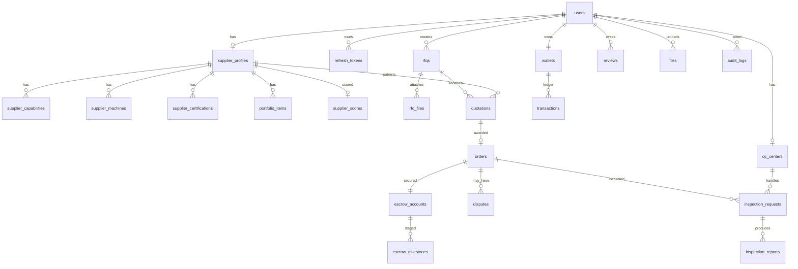

# گزارش معماری — PartMachine

> نسخه ۱.۲ — به‌روزرسانی: ۲۰۲۶/۱۰/۱۴ (پایان فاز ۲) — این سند **طراحی هدف** است؛ آنچه واقعاً پیاده شده در بخش ۴ و [SECURITY_MODEL.md](SECURITY_MODEL.md) آمده است.

## ۱. نمای کلی

PartMachine یک بازار صنعتی B2B است که پنج نقش اصلی دارد: تأمین‌کننده (قطعه‌ساز)، کارفرما (خریدار)، مأمور خرید، مرکز کنترل کیفیت (QC) و مدیر پلتفرم. هدف: مقیاس‌پذیری تا +۱۰۰هزار کاربر و میلیون‌ها رکورد.

## ۲. معماری کلان

```
[Next.js 16 (RTL/fa)] ──HTTPS──> [FastAPI v1 REST]
                                     │
                  ┌──────────────────┼──────────────────┐
            [PostgreSQL 17]      [Redis 7]         [MinIO / S3]
            (داده‌ی اصلی)     (کش/سشن/صف/ریت‌لیمیت)  (فایل‌های CAD/PDF)
                                     │
                              [AI Services Layer]
                     (Trust Score | Matching | Fraud | Doc Analysis)
```

### تصمیم‌های کلیدی (ADR خلاصه)

| # | تصمیم | دلیل |
|---|---|---|
| 1 | Monorepo با `frontend/` و `backend/` | استقرار هماهنگ، CI ساده‌تر، قرارداد API مشترک |
| 2 | REST نسخه‌دار (`/api/v1`) با OpenAPI | پایداری قرارداد برای کلاینت‌های آینده (موبایل) |
| 3 | JWT کوتاه‌عمر (۱۵ دقیقه، فقط در حافظه‌ی مرورگر) + Refresh Token مات و چرخشی در کوکی HttpOnly (فقط هش آن در DB) | امنیت + امکان ابطال + تشخیص استفاده مجدد (reuse detection)؛ پیش‌نیاز: استقرار هم‌سایت فرانت و API |
| 4 | RBAC با نقش پایه + مجوزهای ریز در لایه‌ی سرویس | پنج نقش مشخص با مرز روشن |
| 5 | پول به‌صورت `BIGINT` به ریال (IRR) | جلوگیری از خطای اعشاری؛ درگاه‌های ایرانی ریالی‌اند |
| 6 | موتورهای AI به‌صورت سرویس ماژولار با اینترفیس مشترک | تعویض‌پذیری مدل/Provider بدون تغییر API |
| 7 | آپلود فایل با Presigned URL مستقیم به S3 | عدم عبور فایل سنگین CAD از API server |
| 8 | فرانت RTL-first با Tailwind v4 و توکن‌های تم | بازار ایران، فارسی‌زبان |
| 9 | مرز مستاجر = `organizations`؛ مالکیت داده با `organization_id` | یک شرکت چند کاربر خواهد داشت؛ مجوزدهی از ابتدا روی tenant |
| 10 | قرارداد API: JSON با camelCase، خطای یکسان `{detail, code, errors?, requestId}` با پیام فارسی، لیست‌ها `{items,total,limit,offset}` | فرانت و کلاینت‌های آینده با یک قالب کار می‌کنند؛ تایپ‌های فرانت از OpenAPI تولید می‌شوند |
| 11 | داده‌ی نمونه فقط در build نمایشی (`NEXT_PUBLIC_DEMO_MODE`) | تولید هرگز داده‌ی ساختگی یا موفقیت جعلی نشان نمی‌دهد |

## ۳. فرانت‌اند

- **Next.js 16 (App Router)** — Server Components به‌صورت پیش‌فرض؛ Client Components فقط برای تعامل (فرم‌ها، استورها).
- **TailwindCSS v4** — پیکربندی CSS-first با `@theme`؛ فونت وزیرمتن؛ `dir="rtl"` در ریشه.
- **shadcn/ui-style** — کامپوننت‌های ui داخل `src/components/ui` با CVA.
- **React Query v5** — داده‌ی سرور (لیست تأمین‌کننده‌ها، RFQها)؛ کش و revalidate.
- **Zustand v5** — وضعیت کلاینت (سشن کاربر، UI state).
- **لایه‌ی API** (`src/lib/api-client.ts`) — کلاینت fetch که توکن را خودکار می‌فرستد، روی 401 یک‌بار نشست را تازه می‌کند و خطاها را با پیام فارسی و خطای هر فیلد برمی‌گرداند. داده‌ی نمونه **فقط** در build نمایشی استفاده می‌شود؛ در غیر آن خطا با دکمه‌ی «تلاش دوباره» نمایش داده می‌شود.
- **نشست** (`src/features/auth`) — access token فقط در حافظه؛ بازیابی بی‌صدای نشست با کوکی HttpOnly هنگام باز شدن سایت؛ محافظ صفحات خصوصی (`RequireAuth`) فقط برای تجربه‌ی کاربری.
- **قرارداد API** — `src/lib/api/schema.ts` از `backend/openapi.json` تولید می‌شود (`npm run gen:api`) و `src/lib/api/contract.ts` سازگاری را در typecheck می‌سنجد.

### ساختار مسیرها

```
/                  → لندینگ
/login /register   → احراز هویت
/suppliers         → جستجو و فیلتر تأمین‌کننده‌ها
/suppliers/[id]    → پروفایل تأمین‌کننده (توانمندی، ماشین‌آلات، گواهی، امتیاز اعتماد)
/rfqs              → لیست RFQهای من
/rfqs/new          → ثبت RFQ (متریال، تعداد، مهلت؛ فعلاً فقط متادیتای فایل‌ها)
/rfqs/[id]         → جزئیات RFQ (مالک: کامل؛ قطعه‌ساز: خلاصه)
/dashboard         → داشبورد نقش‌محور
/orders            → سفارش‌ها و قرارداد (فعلاً فقط در نسخه‌ی نمایشی؛ در تولید «به‌زودی»)
```

## ۴. بک‌اند (پیاده‌شده در فاز ۱ و ۲)

- FastAPI + Python 3.13، SQLAlchemy 2.x async + asyncpg، Pydantic v2، Alembic، Redis.
- **مونولیت ماژولار:** `app/modules/{identity, organizations, agreements, files, suppliers, verification, rfqs, quotations, pricing, audit, admin}`، هر ماژول با `models`، `schemas`، `router` و `service` (و `policies`/`lifecycle` برای قواعد دسترسی و وضعیت). زیرساخت مشترک در `app/core` (تنظیمات، خطاها، لاگ، middleware، محدودیت نرخ، امنیت، ذخیره‌ی فایل و ارسال کد).
- **فایل‌ها:** رابط `Storage` با پیاده‌سازی دیسک محلی (P6)؛ نسخه‌ی S3-سازگار با انتخاب سرویس در فاز ۴ اضافه می‌شود. بارگذاری مستقیم از API با بررسی محتوای واقعی؛ دانلود با لینک امضاشده‌ی کوتاه‌عمر.
- **ارسال کد:** رابط `CodeSender` (`console` در توسعه، `disabled` در تولید تا انتخاب سرویس پیامک/ایمیل؛ P8).
- **داده:** فقط PostgreSQL؛ schema با Alembic (`create_all` حذف شده). بدون relationship ضمنی در ORM (کوئری صریح). قیود یکپارچگی در خود پایگاه داده.
- **امنیت:** Argon2id، نشست کوکی‌دار با چرخش و تشخیص سرقت، CSRF برای endpointهای کوکی‌محور، محدودیت نرخ در Redis، audit برای رویدادهای مهم، و اعتبارسنجی پیکربندی هنگام شروع. جزئیات در [SECURITY_MODEL.md](SECURITY_MODEL.md).
- **عملیات:** لاگ JSON با request-id، `/health` (liveness) و `/ready` (DB و Redis)، TrustedHost، سقف حجم درخواست، و `statement_timeout` روی اتصال‌ها. `/metrics` و Sentry در فاز ۴.
- **هنوز پیاده نشده:** سفارش، قرارداد، پرداخت و escrow (فاز ۳)، ذخیره‌ی S3 و اسکن ویروس (فاز ۴)، موتورهای AI (فاز ۵). موتور Trust Score، برآورد قیمت و «امتیاز ترکیبی» پیشنهادها فرمول‌های قطعی و شفاف‌اند، نه هوش مصنوعی.

## ۵. طرح دیتابیس (ERD خلاصه)



> این ERD طرح هدف است. جداول پیاده‌شده تا پایان فاز ۲: `organizations`، `organization_invites`، `users`، `refresh_tokens`، `agreement_acceptances`، `suppliers` (توانمندی‌ها، ماشین‌آلات و گواهی‌ها فعلاً JSONB)، `verification_requests`، `files`، `rfqs`، `quotations` و `audit_events`. ستون قدیمی `rfqs.files` (متادیتای JSONB فاز ۱) دیگر استفاده نمی‌شود و حذفش migration مخرب است که تأیید مالک را لازم دارد. شناسه‌ها فعلاً UUIDv4 هستند.

### نکات مقیاس‌پذیری

- ایندکس‌های ترکیبی روی `(status, created_at)` برای RFQ و سفارش‌ها؛ GIN روی فیلدهای JSONB و جستجوی متنی (pg_trgm).
- پارتیشن‌بندی `audit_logs` و `transactions` بر اساس ماه (RANGE on created_at).
- شناسه‌ها UUIDv7 (ترتیب‌پذیر، مناسب ایندکس B-Tree).
- خواندن‌های سنگین (جستجوی تأمین‌کننده، امتیازها) پشت کش Redis با TTL.

## ۶. موتورهای AI (معماری ماژولار)

هر موتور یک سرویس مستقل با اینترفیس مشترک `score(input) -> ScoredResult(value, components, explanation)`:

1. **Trust Score** — مدل وزن‌دار explainable روی: تحویل به‌موقع، امتیاز کیفیت، نرخ ردی، رضایت مشتری، تعداد کار تکمیل‌شده، سرعت پاسخ، سابقه‌ی اختلاف → خروجی: Trust / Risk / Reliability / Quality (۰–۱۰۰) + توضیح هر مؤلفه.
2. **Matching Engine** — رتبه‌بندی تأمین‌کننده برای هر RFQ: تطبیق توانمندی، فاصله‌ی جغرافیایی، عملکرد تحویل، کیفیت، ظرفیت آزاد، سابقه.
3. **Fraud Detection** — قواعد + ناهنجاری‌یابی (قیمت غیرعادی، الگوی ریویو جعلی، ثبت‌نام مشکوک).
4. **Document Analysis** — اینترفیس Provider-محور برای LLM (استخراج هزینه‌ی متریال/دستمزد/مالیات/بیمه/حمل از قرارداد و فاکتور). اتصال Provider در افزایش ۴.

اجرای کارهای سنگین AI به‌صورت async از طریق صف Redis.

## ۷. Escrow

ماشین حالت: `FUNDED → LOCKED → IN_PRODUCTION → QC_PASSED → BUYER_CONFIRMED → RELEASED` با شاخه‌های `REFUNDED` و `DISPUTED`. آزادسازی جزئی و مرحله‌ای از طریق `escrow_milestones`. درگاه پرداخت پشت اینترفیس `PaymentGateway` (پیاده‌سازی آینده: زرین‌پال و…).
